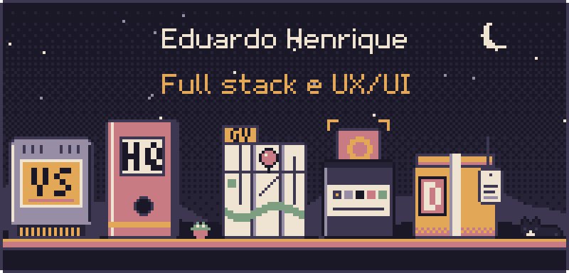

  

  Faço software de ponta a ponta: entendo o problema, desenho a interface e coloco no ar. 
  Governador Valadares (MG) · <a href="https://eduardohenrique-nu.vercel.app">portfólio</a> · <a href="mailto:edu.hcdev@gmail.com">edu.hcdev@gmail.com</a>

## Projetos

Cada repositório tem um README com o passo a passo para rodar. Os que lidam com dados de pessoas ou de uma organização não publicam o código original: o que está aqui é uma **demo**, sobre dados fictícios, e diz isso logo no começo.

### No ar, com o código aberto para consulta

| Projeto | O que é | Stack |
| --- | --- | --- |
| [**gvtem**](https://github.com/eduardohenrique-dev/gvtem) · [site](https://gvtem.vercel.app) | Guia de comércios e serviços de Governador Valadares, com busca que tolera erro de digitação, avaliações e painel para os negócios | Next.js 16, Prisma, PostgreSQL |
| [**deck-scanner**](https://github.com/eduardohenrique-dev/deck-scanner) · [site](https://deck-scanner.vercel.app) | Aponte a câmera para as cartas de Magic e receba a decklist pronta | FastAPI, React, OpenCV |
| [**portfolio**](https://github.com/eduardohenrique-dev/portfolio) · [site](https://eduardohenrique-nu.vercel.app) | Esta página que vira noite conforme você rola, em pixel art desenhada em código | Next.js, GSAP |
| [**cozinha**](https://github.com/eduardohenrique-dev/cozinha) | Receitas, calorias, água e despensa: registrar uma refeição desconta o estoque | Next.js, Prisma, SQLite |
| [**dgames**](https://github.com/eduardohenrique-dev/dgames) | Estoque e lucro de uma loja de games, em um arquivo só que abre com dois cliques | React, Tailwind |
| [**lol-draft-analyzer**](https://github.com/eduardohenrique-dev/lol-draft-analyzer) | App desktop que lê o draft de League of Legends competitivo e calcula o Prio Score | Python, Qt, pandas |
| [**figjam-dark-dots**](https://github.com/eduardohenrique-dev/figjam-dark-dots) | Plugin do FigJam com fundo escuro pontilhado e o contraste calculado pela fórmula WCAG | TypeScript |

### Demos (o sistema real é privado)

| Demo | O que é |
| --- | --- |
| [**einerd-scrims-demo**](https://github.com/eduardohenrique-dev/einerd-scrims-demo) · [abrir](https://einerd-scrims-demo.vercel.app) | Gestão de treinos de um time de League of Legends: blocos, drafts, estatísticas e dados de partidas |
| [**einerd-hq-demo**](https://github.com/eduardohenrique-dev/einerd-hq-demo) · [abrir](https://einerd-hq-demo.vercel.app) | Central de gestão de um time de esports: agenda, tarefas, prestação de contas, elenco e chat |
| [**duda-west-agenda-demo**](https://github.com/eduardohenrique-dev/duda-west-agenda-demo) | Agenda e cadastro de alunos para uma professora de inglês, em um arquivo só |

## Pilha

  

TypeScript, React, Next.js, Vite, Tailwind CSS, Node.js, PostgreSQL, Supabase, Prisma, Python, OpenCV, GSAP, Vitest e Vercel.

## Além do código

Head Coach de League of Legends no EiNerd.

Feito em Governador Valadares (MG).

